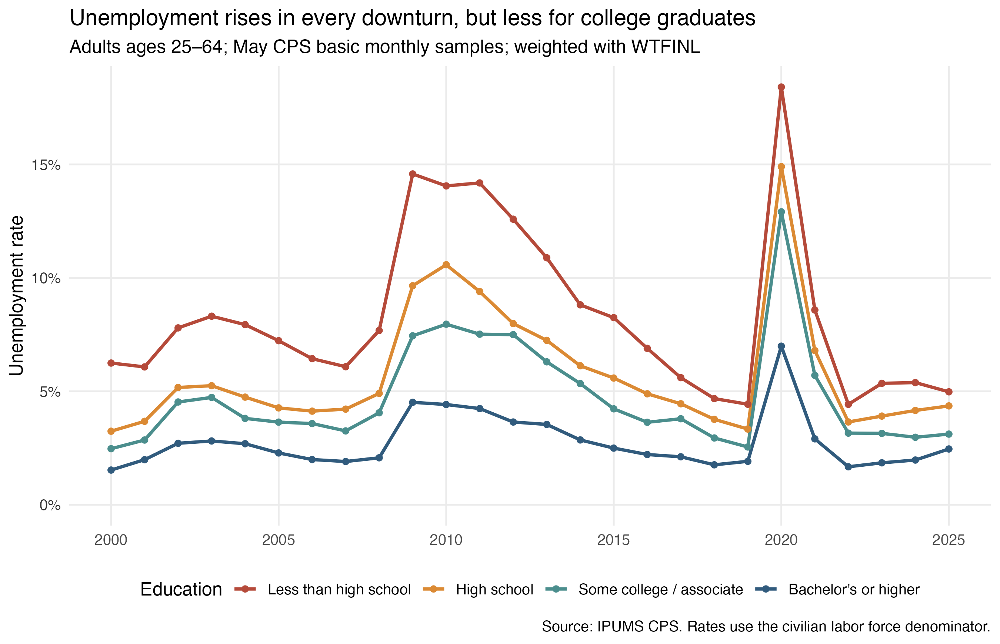
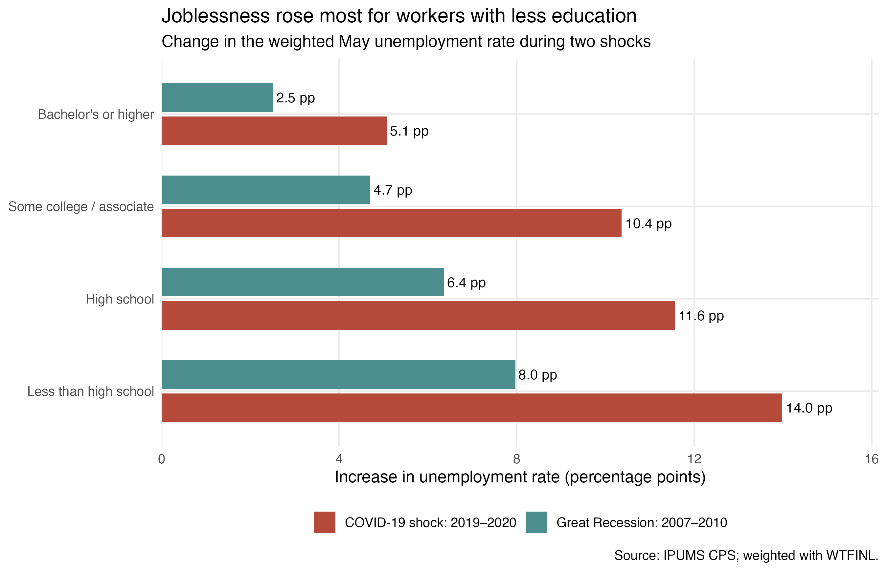
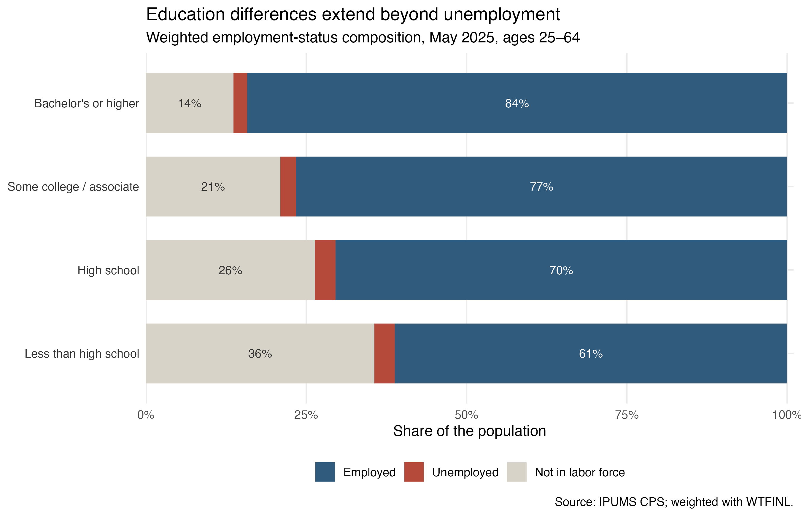

## A question about risk, not just credentials

A college degree is often discussed as a route to higher pay. But education may also act as **insurance against unemployment**. This post asks: *How has unemployment varied by education since 2000, and who absorbed the largest employment shocks during the Great Recession and COVID-19?* The distinction matters for students choosing education, workers considering retraining, and policymakers deciding where recession support should be concentrated.

The answer is not a causal estimate of what a degree does to one individual. Education is related to occupation, age, location, and many other characteristics. Instead, this is a careful description of how labor-market risk is distributed across education groups—and how that distribution changes in a crisis.

## Data, definitions, and weights

I use **IPUMS Current Population Survey (CPS)** basic monthly microdata for every May from 2000 through 2025. Keeping the same calendar month makes the annual comparisons less vulnerable to seasonality. I restrict the sample to civilians ages 25–64: most have completed schooling, and most have not reached conventional retirement age.

Education is grouped into less than high school, high school, some college/associate degree, and bachelor's degree or higher. Following the official CPS definition, the unemployment rate is

$$
\text{Unemployment rate}=
\frac{\text{unemployed}}{\text{employed}+\text{unemployed}}.
$$

People outside the labor force are therefore absent from this denominator. I examine them separately in the third figure.

Most importantly, every estimate uses `WTFINL`, the final person-level basic monthly weight. A CPS record does not represent only itself; it represents a different number of people in the U.S. population. Ignoring those weights would describe the downloaded sample rather than the population the survey was designed to measure.

```{r}
#| eval: false
# Core weighting step used inside R/01_analysis.R
unemployment_trend <- cps |>
  filter(in_labor_force) |>
  group_by(year, education) |>
  summarise(
    unemployment_rate = weighted.mean(unemployed, weight),
    .groups = "drop"
  )
```

## A persistent education gradient

{fig-alt="Line chart of weighted May unemployment rates by four education groups from 2000 through 2025. All groups rise in recessions, with the highest rates among adults without a high-school diploma and the lowest among adults with a bachelor's degree or higher."}

The lines move together over the business cycle, but they rarely cross. In May 2007, before the Great Recession, unemployment was **6.1%** for adults without a high-school diploma and **1.9%** for college graduates. By May 2010, those rates had reached **14.1%** and **4.4%**, respectively. Recovery lowered every line, yet it did not erase the gradient.

COVID-19 produced a much sharper one-year spike. Between May 2019 and May 2020, unemployment increased from **4.4% to 18.4%** for adults without a high-school diploma, compared with **1.9% to 7.0%** for college graduates. Both groups suffered; the size of the shock was highly unequal.

## Recessions magnify existing inequality

{fig-alt="Grouped horizontal bars showing increases in unemployment, in percentage points, by education during the Great Recession and COVID-19. In both shocks the increase is larger for groups with less education."}

The comparison in percentage points makes the pattern clearer. During the Great Recession, the increase ranged from **2.5 points** for college graduates to **8.0 points** for those without a high-school diploma. During the COVID-19 shock, it ranged from **5.1 to 14.0 points**. Jobs held by less-educated workers were more exposed to shutdowns and were often harder to perform remotely, while many college-intensive occupations could continue from home.

This does not mean education fully protected workers. It means that the existing education gap became wider exactly when employment security mattered most.

## Unemployment is only part of the story

{fig-alt="One-hundred-percent stacked bars showing weighted employment, unemployment, and nonparticipation shares in May 2025. Employment rises and nonparticipation falls with education."}

By May 2025, unemployment had largely retreated, but employment-to-population differences remained. About **84%** of working-age college graduates were employed, versus **61%** of adults without a high-school diploma. The latter group also had a much larger share outside the labor force: **36% versus 14%**. This is why a low unemployment rate alone cannot summarize labor-market attachment.

## Takeaway

Education is associated with two forms of labor-market advantage: lower unemployment in normal years and smaller increases during major shocks. The actionable lesson is targeted rather than universal. Recession policy, rapid retraining, and job-search support should reach workers with less education early, because their unemployment rises first and furthest. For individuals, education can be viewed not only as an investment in earnings, but also as partial protection against cyclical job loss.

## Reproducibility and source

The complete R script, weighted aggregate tables, and exported figures are available in the [project repository](https://github.com/haozhuo22/blog-post-3-cps). Raw IPUMS microdata are excluded under the IPUMS terms; registered users can reproduce the extract using the documented samples and variables.

**Citation:** Sarah Flood, Miriam King, Renae Rodgers, Steven Ruggles, J. Robert Warren, Daniel Backman, Etienne Breton, Grace Cooper, Julia A. Rivera Drew, Stephanie Richards, David Van Riper, and Kari C.W. Williams. *IPUMS CPS: Version 13.0* [dataset]. Minneapolis, MN: IPUMS, 2025. [https://doi.org/10.18128/D030.V13.0](https://doi.org/10.18128/D030.V13.0).
