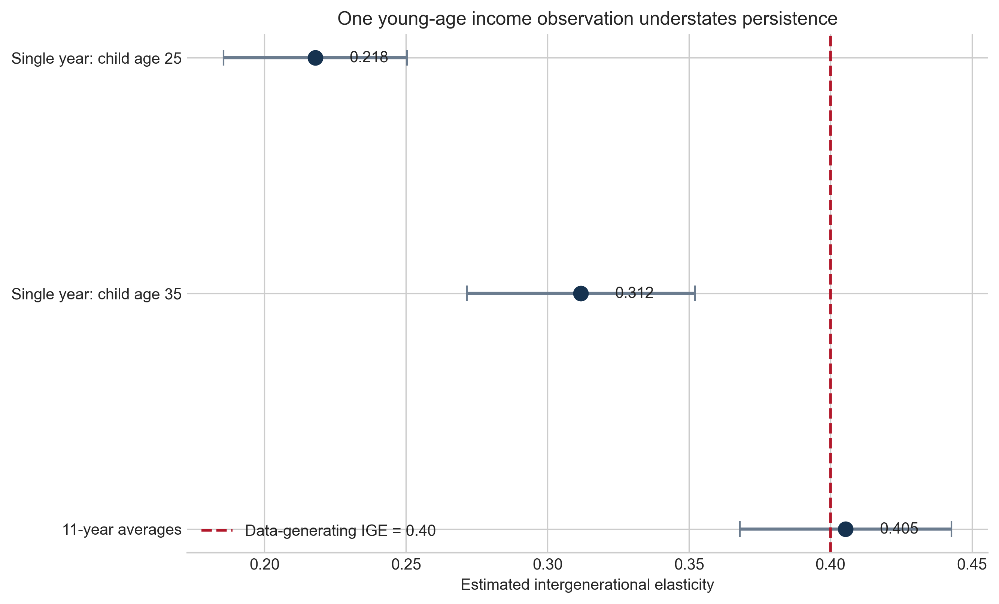
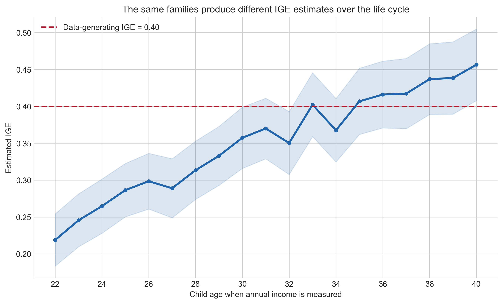
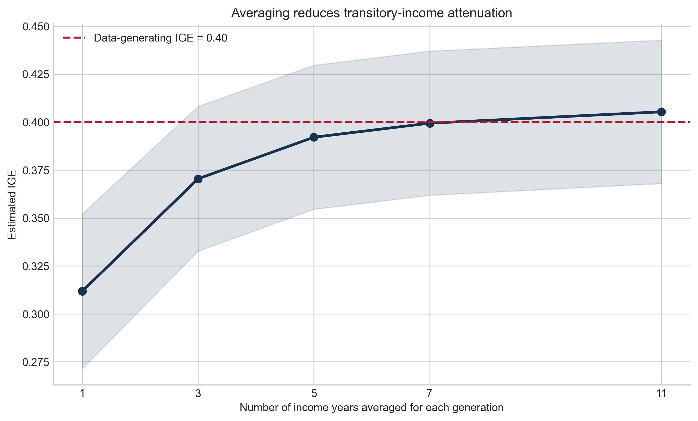

## Why matching is the first econometric problem

Intergenerational mobility asks how strongly children's economic outcomes are related to their parents' outcomes. Before estimating anything, however, we must solve a database problem: income appears in person-year rows, while family relationships appear in a person table. SQL is well suited to connecting those structures.

This tutorial uses a **synthetic PSID-style panel** of 2,000 families. Each family has one parent and one child, parents are observed from ages 35–55, and children from ages 22–40. The random seed is fixed, and the data-generating intergenerational elasticity (IGE) is 0.40. Synthetic data make the exercise fully reproducible and let us see measurement bias against a known benchmark; the estimates below are demonstrations, not claims about U.S. mobility.

The project contains two tables:

- `people(person_id, family_id, role, birth_year)` identifies people and relationships.
- `income(person_id, year, age, income)` stores repeated annual observations.

## Step 1: construct parent–child links

A **self-join** treats the `people` table as two temporary tables. `c` supplies children and `p` supplies parents. The `ON` clause requires a common family identifier, while the role conditions prevent child-to-child or parent-to-parent matches.

```sql
SELECT
    c.family_id,
    c.person_id AS child_id,
    p.person_id AS parent_id
FROM people AS c
JOIN people AS p
  ON c.family_id = p.family_id
 AND c.role = 'child'
 AND p.role = 'parent';
```

This produces exactly 2,000 unique links. In real data I would also inspect duplicate links, missing identifiers, relationship codes, and household changes before proceeding.

## Step 2: turn annual income into economic status

The next query uses `GROUP BY person_id` so every individual contributes one row. `CASE WHEN` selects a particular age; `AVG` combines repeated observations. Common table expressions keep each transformation readable.

```sql
WITH parent_income AS (
  SELECT person_id,
    MAX(CASE WHEN age = 45 THEN income END) AS income_age45,
    AVG(CASE WHEN age BETWEEN 40 AND 50 THEN income END) AS income_avg
  FROM income GROUP BY person_id
),
child_income AS (
  SELECT person_id,
    MAX(CASE WHEN age = 25 THEN income END) AS income_age25,
    MAX(CASE WHEN age = 35 THEN income END) AS income_age35,
    AVG(CASE WHEN age BETWEEN 30 AND 40 THEN income END) AS income_avg
  FROM income GROUP BY person_id
)
SELECT l.*, p.income_age45, p.income_avg,
       c.income_age25, c.income_age35, c.income_avg
FROM parent_child_links AS l
JOIN parent_income AS p ON l.parent_id = p.person_id
JOIN child_income AS c ON l.child_id = c.person_id;
```

The resulting analysis file has one family per row and preserves both IDs, making every estimate auditable.

## Step 3: estimate the IGE

The standard log–log model is

$$
\log(Y_i^{child})=\alpha+\beta\log(Y_i^{parent})+\varepsilon_i.
$$

The slope \(\beta\) is the IGE: an approximate 10% difference in parental income is associated with a \(10\beta\)% difference in child income. Larger values mean more persistence and less mobility.

{fig-alt="Three coefficient estimates show an IGE of 0.218 using child income at age 25, 0.312 using age 35, and 0.405 using eleven-year averages; the known benchmark is 0.40." fig-cap="The estimated IGE depends strongly on when and how income is measured. Points show OLS slopes; bars show 95% confidence intervals."}

Using one observation for the parent at age 45 and the child at age 25 gives an IGE of **0.218**. Moving the child observation to age 35 raises it to **0.312**. Averaging income across ages 40–50 for parents and 30–40 for children produces **0.405**, almost exactly the known value.

## Why a young observation creates life-cycle bias

Workers do not follow identical earnings paths. In the simulation, people with higher long-run income have steeper early-career growth. At age 25, their current income has not yet revealed their eventual position. Regressing this incomplete signal on parental income compresses the child-income gradient.

{fig-alt="A line chart shows the estimated IGE rising from about 0.22 at child age 22 toward and above 0.40 in the mid-to-late thirties." fig-cap="Holding the matched families fixed, the single-year IGE changes systematically with the child's age. Shading shows 95% confidence intervals."}

This is life-cycle bias: the same families imply different mobility depending on the child's age at measurement. It is a property of the measurement strategy, not evidence that mobility literally changes as these children age.

## Why averaging helps

Even at a sensible age, annual income contains bonuses, unemployment spells, and other temporary shocks. Averaging reduces this noise for both generations.

{fig-alt="A line chart shows the IGE increasing from about 0.31 with one year to about 0.41 with eleven years averaged." fig-cap="IGE estimates converge toward the known 0.40 benchmark as more income years are averaged around mid-career."}

With one mid-career year for each generation, the estimate is 0.312. It rises to 0.370 with three years, 0.392 with five, and 0.405 with eleven. The practical lesson is direct: **match people carefully, measure income at comparable life-cycle stages, and use multi-year averages whenever the panel permits.**

## Reproduce the tutorial

```bash
python3 -m venv .venv
source .venv/bin/activate
pip install -r requirements.txt
python analysis.py
```

The complete SQLite database, generated raw tables, matched dataframe, coefficient tables, figures, and source code are available in the [project repository](https://github.com/haozhuo22/blog-post-6-sql-intergenerational-mobility).
