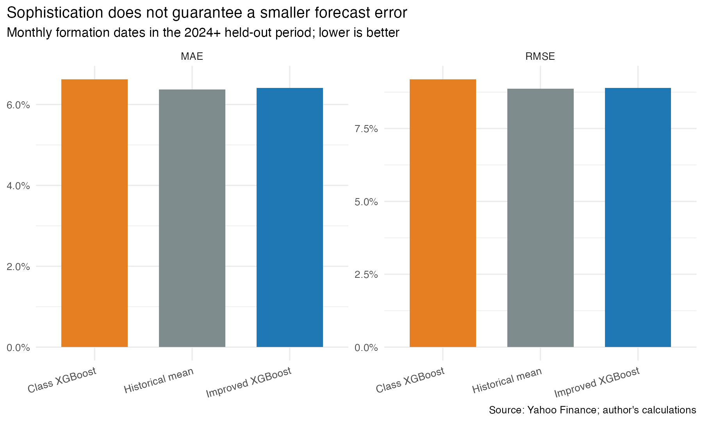
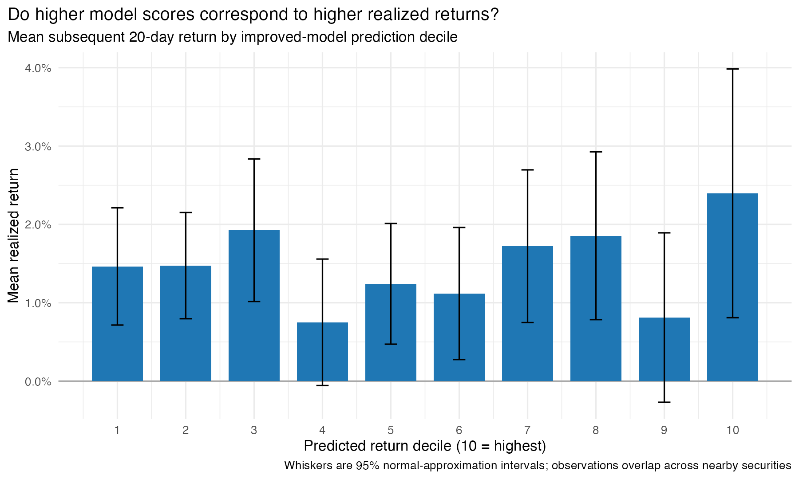
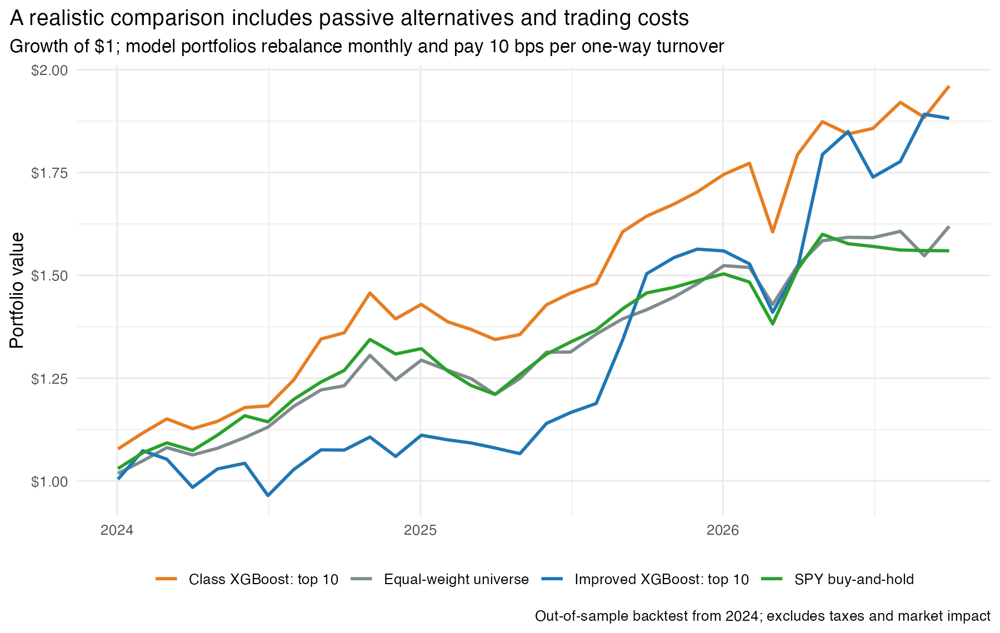
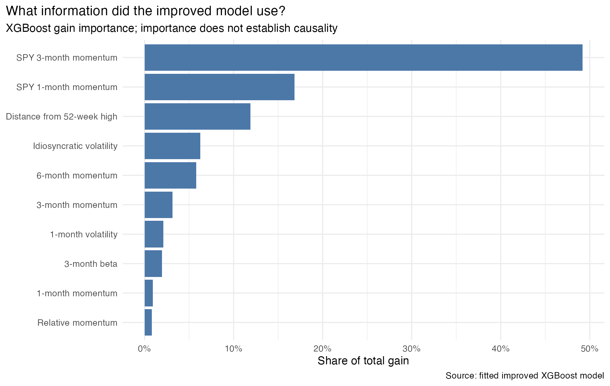

## The experiment—and the difficult question

Our class experiment asks XGBoost to predict which large U.S. stocks will perform best over the next 20 trading days. This is an appealing machine-learning problem: boosted trees can combine momentum, volatility, and reversal signals nonlinearly. Yet stock returns have a weak signal, high noise, changing relationships, and prices that quickly incorporate public information. A flexible model may therefore learn yesterday's accidents instead of tomorrow's pattern.

I reproduce the class specification and ask a stricter question: **does an improved model beat both the original XGBoost and a historical-mean forecast on data that played no role in training or tuning?** I also test whether its rankings produce an economically meaningful portfolio after turnover costs.

## Data and prediction target

Using `tidyquant::tq_get()`, I collected daily adjusted prices from Yahoo Finance for SPY and 95 diversified large U.S. stocks. Adjusted prices account for splits and distributions. The usable panel begins in 2018, while every reported result comes from the untouched January 2024–October 2026 test period.

For stock $i$ on formation date $t$, the target is the return beginning after formation:

$$
y_{i,t}=\frac{P_{i,t+20}}{P_{i,t+1}}-1.
$$

This timing prevents future prices from entering the predictors. Because the horizon is about one month, I evaluate one formation date per month rather than treating heavily overlapping daily forecasts as independent.

```{r}
prices <- tq_get(tickers, from = "2017-01-01", to = Sys.Date())
target <- lead(adjusted, 20) / lead(adjusted, 1) - 1
```

The class model uses six signals, 300 trees, depth 5, and the original 2022–2023 training window. My improved version corrects the direction of the momentum ratios; adds market momentum, beta, idiosyncratic volatility, liquidity, relative momentum, and distance from the 52-week high; and uses data back to 2018. I tune four regularized specifications on **2023 only**, choosing depth 2, learning rate 0.03, 80% row and feature subsampling, and 300 rounds. I then refit through 2023 and open the 2024+ test set once.

```{r}
fit <- xgb.train(
  params = list(objective = "reg:squarederror", max_depth = 2,
                eta = 0.03, subsample = 0.8, colsample_bytree = 0.8,
                lambda = 10, alpha = 0.5),
  data = training_matrix, nrounds = 300
)
```

## Predictive accuracy: improvement is not victory

| Model | RMSE | MAE | Out-of-sample $R^2$ | Direction accuracy | Mean rank IC |
|---|---:|---:|---:|---:|---:|
| Historical mean | 8.87% | 6.37% | -1.13% | 55.4% | — |
| Class XGBoost | 9.19% | 6.63% | -8.57% | 50.4% | 0.012 |
| Improved XGBoost | 8.90% | 6.41% | -1.75% | 53.4% | -0.031 |

The improved model substantially reduces the class model's error, but it still does **not** beat the historical mean. Out-of-sample $R^2$ is

$$
R^2_{OOS}=1-\frac{\sum(y-\hat y)^2}{\sum(y-\bar y_{train})^2};
$$

a negative value means the model loses to the simple benchmark. Its negative mean monthly rank correlation also says that higher scores did not reliably identify higher returns.

{fig-alt="Forecast error comparison showing the historical mean with the lowest RMSE and MAE, followed closely by improved XGBoost." width="100%"}

The decile test reaches the same conclusion. If the score were useful, realized returns should rise approximately from decile 1 to 10. They do not; sampling uncertainty is large and the pattern is not monotonic.

{fig-alt="Predicted decile returns fluctuate rather than increasing steadily from the lowest to highest decile." width="100%"}

## Did the predictions make money?

Each month I equally weight the ten highest-ranked stocks and subtract 10 basis points times one-way turnover. The improved portfolio earns 25.0% annualized with a 1.23 Sharpe ratio, compared with 26.8% and 1.77 for the class model, 18.5% and 1.71 for the equal-weight universe, and 17.0% and 1.45 for SPY.

{fig-alt="All four strategies grow over the test period, with the class and improved XGBoost portfolios ending above the passive alternatives." width="100%"}

That looks encouraging, but it is not proof of a durable edge. The test contains only 34 monthly decisions, uses today's large-cap universe and therefore has survivorship bias, and omits taxes, bid-ask spreads, and market impact. More revealingly, the improved model's better forecast error does not improve the class model's portfolio, and neither model shows stable cross-sectional ranking power. A few favorable top-decile outcomes can dominate a short backtest.

Market momentum accounts for most fitted gain, followed by distance from the 52-week high and idiosyncratic volatility. Gain measures how often a variable improves tree splits; it is not a causal effect.

{fig-alt="SPY three-month and one-month momentum dominate XGBoost gain importance." width="100%"}

## Takeaway

Careful feature engineering and regularization repaired much of the original model's forecast error, yet they did not beat a constant mean forecast out of sample. The profitable-looking backtest should be treated as a hypothesis for future testing, not an investment recommendation. In noisy adaptive markets, honest time splits, simple benchmarks, costs, and negative results matter more than a sophisticated algorithm's in-sample fit.

**Sources and reproducibility.** Prices are retrieved with [`tidyquant`](https://business-science.github.io/tidyquant/articles/TQ01-core-functions-in-tidyquant.html) from Yahoo Finance. The modeling approach follows [Chen and Guestrin's XGBoost paper](https://arxiv.org/abs/1603.02754); the signal families are motivated by [Gu, Kelly, and Xiu](https://www.nber.org/papers/w25398). The complete R program, cached raw prices, clean panel, predictions, metrics, and figures are in the [project repository](https://github.com/haozhuo22/blog-post-9-gradient-boosting-stock-returns).

